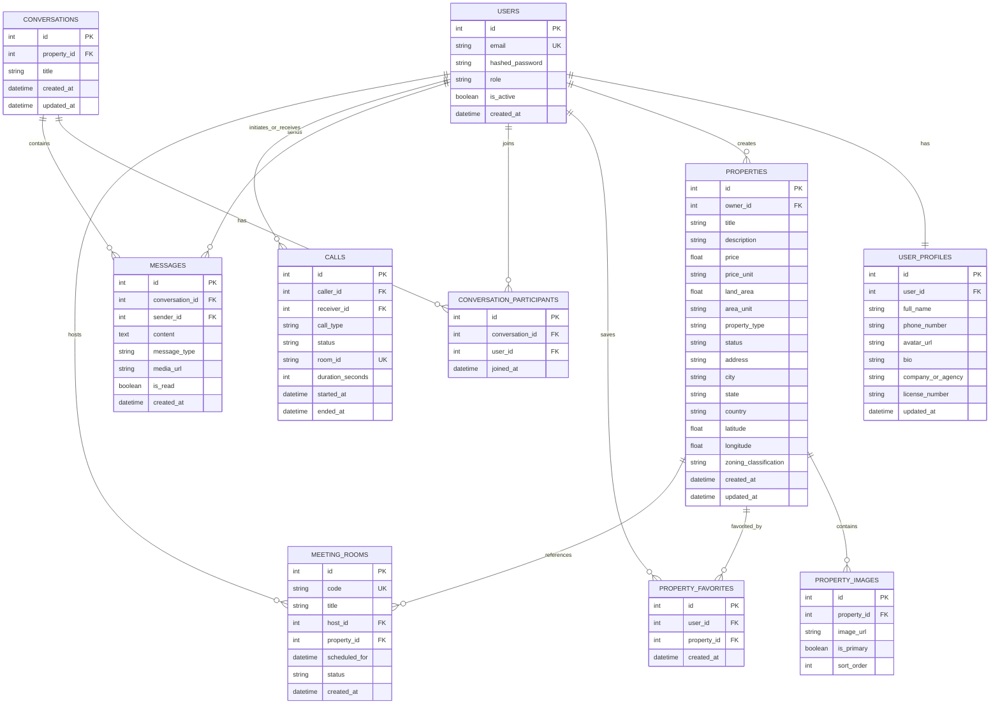
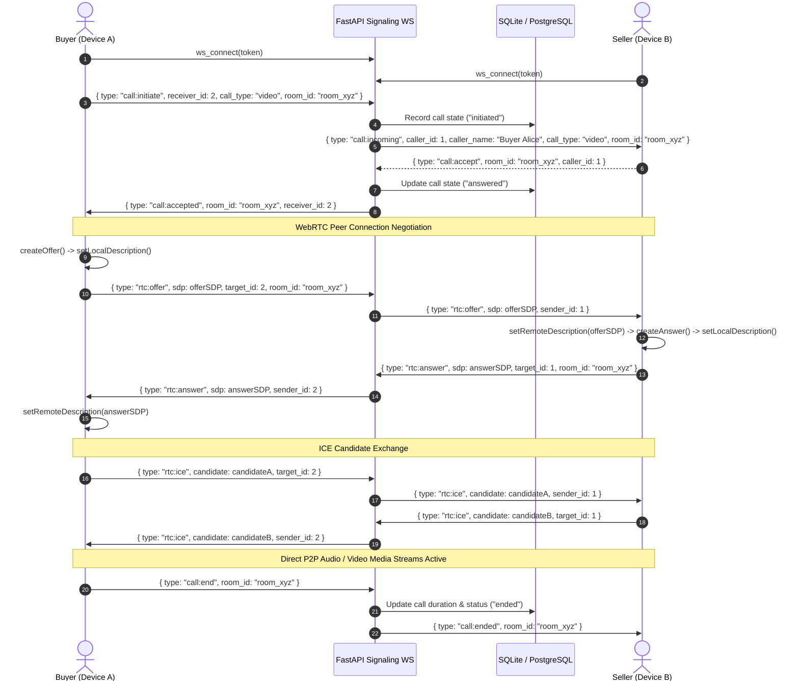

# LandConnect — Architecture & Technical Specification

## 1. System Overview & Objectives
**LandConnect** is a comprehensive, production-grade land marketplace mobile application that unifies land buyers, individual sellers, and licensed brokers. In addition to property discovery, filtering, and listing lifecycle management, LandConnect features an integrated real-time communication suite:
- Persistent in-app messaging (WebSocket & database backed)
- Integrated WebRTC Peer-to-Peer Audio and Video calling
- Virtual meeting-room functionality for land inspections and negotiations
- Role-Based Access Control (RBAC) enforced on the backend for Buyers, Sellers, and Brokers

---

## 2. Technology Stack & Key Decisions

| Layer | Selected Technology | Rationale & Justification |
| :--- | :--- | :--- |
| **Mobile Client** | React Native with Expo & TypeScript | Cross-platform (iOS, Android, and Web preview), rapid iteration, single codebase for native & browser evaluation. |
| **State & Data Fetching** | Zustand + Axios / Fetch API | Lightweight, performant client state without boilerplate; reactive stores for auth, calls, and chat. |
| **Backend API** | Python FastAPI + Uvicorn | Async ASGI architecture, native WebSocket support, high throughput, auto-generated OpenAPI documentation, robust Pydantic data validation. |
| **Database & ORM** | SQLAlchemy with SQLite (default) / PostgreSQL support | Clean relational integrity (foreign keys, cascading deletes, indexes). Works out of the box with zero external configuration on any host machine while fully supporting production PostgreSQL via `DATABASE_URL`. |
| **Real-Time Layer** | FastAPI WebSockets | Single unified signaling channel for direct messaging, live presence, and WebRTC SDP/ICE signaling without requiring external redis/pusher dependencies for prototype demo. |
| **Audio/Video (RTC)** | WebRTC (STUN via Google public STUN + custom signaling) | **Zero third-party vendor lock-in**, no expiring API trial keys or cloud subscription barriers. Directly exchanges SDP Offers/Answers and ICE Candidates. Universal compatibility across native builds and web preview. |
| **Media Storage** | Local static uploads directory + Base64 / Multipart API | Reliable local storage served statically via FastAPI `/uploads`, zero external cloud S3 credential dependencies required during evaluation. |

---

## 3. Role-Based Access Control (RBAC) Matrix

| Feature / Action | Buyer | Seller | Broker |
| :--- | :---: | :---: | :---: |
| Browse & Search Listings | Yes | Yes | Yes |
| View Property Details & Maps | Yes | Yes | Yes |
| Save / Favorite Properties | Yes | Yes | Yes |
| Create New Land Listing | No | Yes (Own) | Yes (Managed/Own) |
| Edit / Update Listing | No | Yes (Owned only) | Yes (Managed/Owned) |
| Deactivate / Delete Listing | No | Yes (Owned only) | Yes (Managed/Owned) |
| Initiate 1-on-1 Chat | Yes | Yes | Yes |
| Initiate Audio Call | Yes | Yes | Yes |
| Initiate Video Call | Yes | Yes | Yes |
| Schedule / Join Meeting Room | Yes | Yes | Yes |
| View Call & Chat History | Own | Own | Own |

---

## 4. Database Schema Design

---

## 5. WebRTC Audio & Video Calling Architecture

### Calling Workflow Sequence

---

## 6. End-to-End API Specifications

### Auth & User APIs
- `POST /api/auth/register` — Register a new user (`email`, `password`, `role`, `full_name`, `phone_number`)
- `POST /api/auth/login` — Login user (`email`, `password`) -> Returns JWT access token & user profile
- `GET /api/auth/me` — Retrieve current authenticated user profile
- `PUT /api/auth/profile` — Update user profile details

### Property APIs
- `GET /api/properties` — List & search properties with query filters (`q`, `type`, `min_price`, `max_price`, `status`, `city`)
- `POST /api/properties` — Create a new property listing (RBAC: Seller or Broker)
- `GET /api/properties/{id}` — Retrieve property details with images & seller profile
- `PUT /api/properties/{id}` — Update property (RBAC: Owner or Broker)
- `DELETE /api/properties/{id}` — Remove property (RBAC: Owner or Broker)
- `POST /api/properties/{id}/images` — Upload listing image
- `POST /api/properties/{id}/favorite` — Toggle bookmark / favorite
- `GET /api/properties/user/favorites` — Get logged-in user's favorites
- `GET /api/properties/user/my-listings` — Get current seller/broker's own listings

### Chat & Messaging APIs
- `GET /api/conversations` — List active conversations for current user
- `POST /api/conversations` — Start or get conversation with another user (optionally linked to property)
- `GET /api/conversations/{id}/messages` — Get message history
- `POST /api/conversations/{id}/messages` — Send message via HTTP (also available via WebSocket)

### Calling & Meeting Room APIs
- `GET /api/calls/history` — Get user's call logs
- `POST /api/calls/initiate` — Create call record
- `POST /api/calls/{id}/status` — Update call state (answered, rejected, ended)
- `GET /api/meetings` — List user's meetings
- `POST /api/meetings` — Schedule a new meeting room
- `GET /api/meetings/{code}` — Get meeting details & participant authorization

### WebSocket Endpoint
- `WS /ws?token={jwt_token}` — Real-time bidirectional connection for:
  - In-app chat messages
  - Incoming call notifications & responses
  - WebRTC SDP Offer / Answer
  - WebRTC ICE Candidates
  - Presence status (online/offline)
